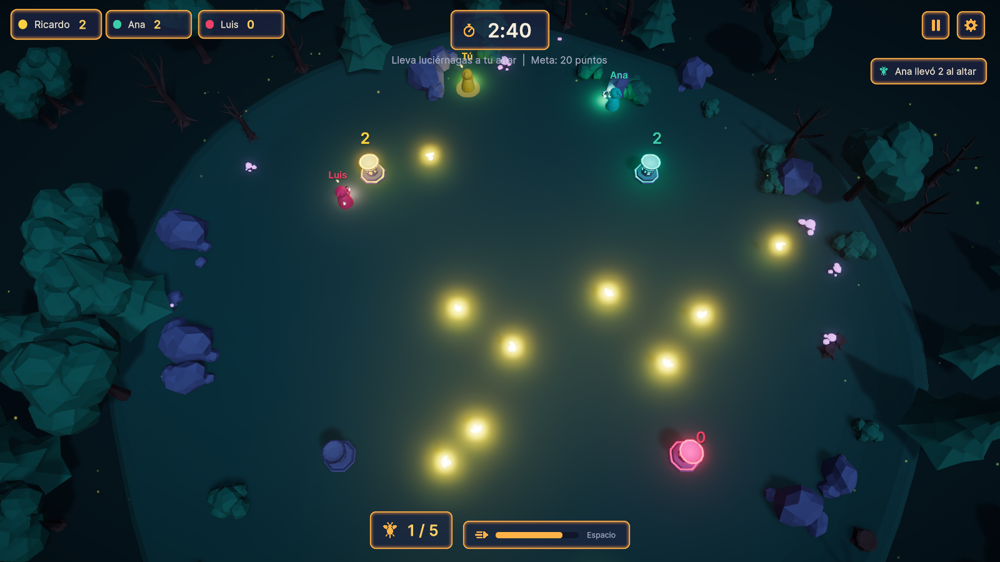
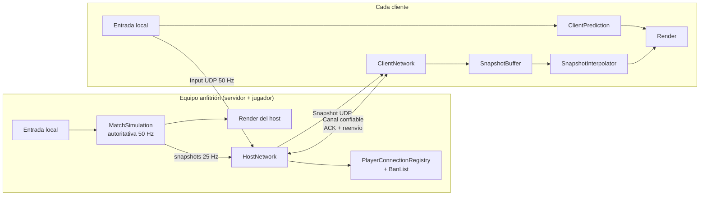
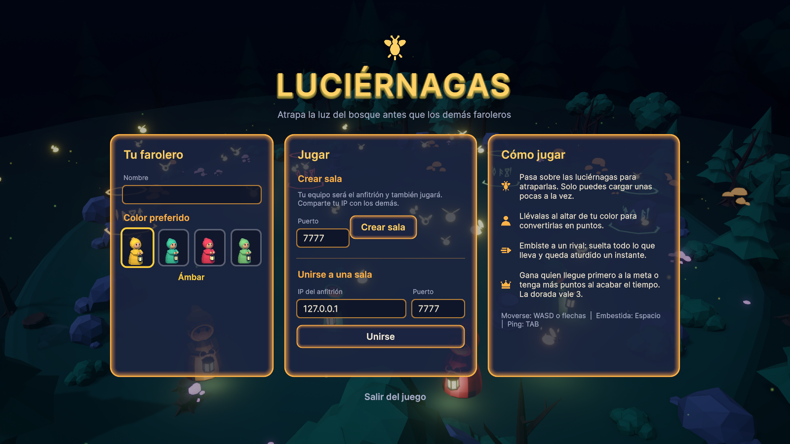
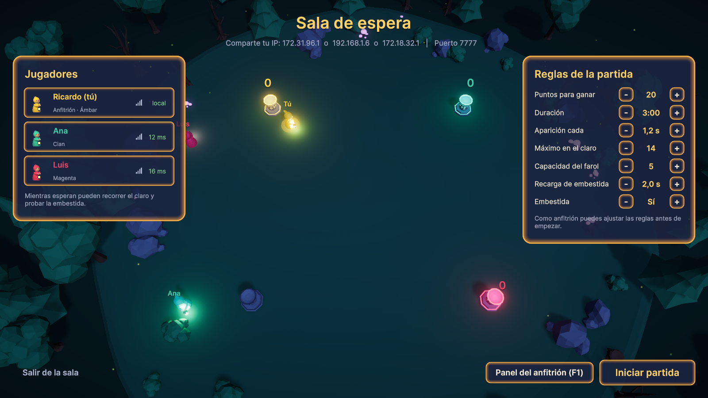
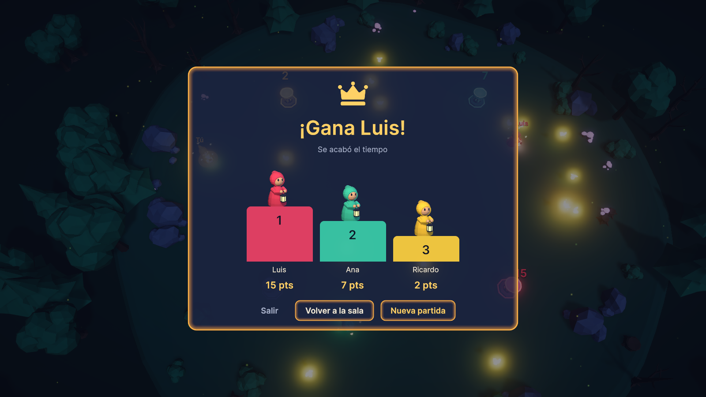

# Luciérnagas

Juego multijugador en red local con arquitectura **Player Host**. Uno de los jugadores crea la sala y su propio juego hace de servidor **y** de jugador al mismo tiempo; los demás se conectan directamente a su IP. No hay servidor dedicado.

Proyecto del curso **Servicios Multimedia** (Universidad), Unity 6 + UDP.



## Integrantes

- Ricardo J Cortes

## Descripción del juego

Es de noche en un claro del bosque. Cada jugador es un **farolero** de un color (ámbar, cian, magenta o verde) y tiene un **altar** propio en una esquina del claro.

- **Objetivo:** atrapar luciérnagas y llevarlas a tu altar. Gana quien llegue primero a la meta (20 puntos por defecto) o quien tenga más puntos cuando se acaba el tiempo (3 minutos por defecto).
- **Recoger:** basta con pasar por encima de una luciérnaga. Solo se pueden cargar unas pocas a la vez (5 por defecto); las que llevas giran alrededor de tu farolero, así todos ven quién va cargado.
- **Embestida (Espacio):** un impulso corto con 2 s de recarga. Si golpeas a un rival, suelta todas las luciérnagas que llevaba y queda aturdido un instante.
- **Luciérnaga dorada:** aparece de vez en cuando y vale 3 puntos.

## Requisitos técnicos

| | |
|---|---|
| Motor | Unity **6000.0.82f1** (Unity 6 LTS) con URP |
| Paquetes | Universal RP 17, Input System 1.19 (UI con UI Toolkit, incluido en Unity) |
| Plataforma | Windows 10/11 de 64 bits (es la que probamos; el código no depende de Windows) |
| Red | Todos los equipos en la misma red local. Puerto **UDP 7777** (configurable) permitido en el firewall del anfitrión |
| Arte | Modelos y sprites hechos por el equipo en Blender 5.2 (las fuentes `.blend` están en `ArtSource/Blender`) |

## Cómo ejecutar

### Desde Unity

1. Abrir la carpeta del repositorio con Unity Hub (Unity 6000.0.82f1).
2. Abrir la escena `Assets/_Project/Scenes/Main.unity` y darle Play.
3. Para probar con varias ventanas en un solo PC, generar un build (`Fireflies > Build Windows Player` en el menú de Unity, queda en `Builds/Windows/Luciernagas.exe`) y abrir varias copias.

### Anfitrión (host)

1. Escribe tu nombre y elige un color.
2. En **Crear sala** deja el puerto 7777 (o elige otro) y pulsa **Crear sala**.
3. En la sala de espera aparece tu IP local: compártela con los demás.
4. Ajusta las reglas si quieres y pulsa **Iniciar partida** cuando estén todos.

### Clientes

1. Escribe tu nombre y elige un color (si ya está ocupado se te asigna otro libre).
2. En **Unirse a una sala** escribe la IP y el puerto del anfitrión y pulsa **Unirse**.
3. Se puede entrar también con la partida ya empezada.

### Controles

| Tecla | Acción |
|---|---|
| WASD / flechas / stick izquierdo | Moverse |
| Espacio / botón A | Embestida |
| TAB (mantener) | Ver el ping de todos los jugadores |
| P o botón «Pausa» | Pausar / reanudar (solo anfitrión) |
| F1 o botón «Panel» | Panel del anfitrión (solo anfitrión; también desde la sala y la pausa) |
| Botón «Salir» | Salir de la sala en cualquier momento |
| F3 / F4 | Datos de red / apagar la interpolación para comparar (cliente) |

### Opciones por línea de comandos (pruebas)

```bash
Luciernagas.exe -host -name Ana -slot 0 -port 7777
Luciernagas.exe -join 192.168.1.20 -port 7777 -name Luis
```

`-autopilot` mueve al jugador solo y `-autostart 3` hace que el anfitrión empiece cuando haya 3 jugadores; con `-batchmode -nographics` se pueden lanzar instancias sin ventana para pruebas largas de estabilidad. `-quitafter <s>` cierra el juego tras ese tiempo y `-capture <archivo.png> -captureafter <s>` guarda una captura de pantalla.

## Funcionalidades implementadas

### Arquitectura Player Host sobre UDP

Partimos de la implementación vista en clase (`UdpClient` con `async/await`, proyecto *Chat-TCP-UDP-base*) y la ampliamos:

- **Varios clientes:** el servidor de clase guardaba un único `remoteEndPoint`; aquí `PlayerConnectionRegistry` mantiene un diccionario `IPEndPoint → ConnectedClient`.
- **Cola de recepción:** una tarea en segundo plano recibe los datagramas y los mete en una `ConcurrentQueue`; el hilo principal de Unity la vacía en cada frame (mismo patrón productor/consumidor de los ejercicios de concurrencia del curso).
- **Protocolo binario propio:** cabecera de 6 bytes (identificador de protocolo, canal, secuencia y tipo) y mensajes serializados con `BinaryWriter`. Cada lectura valida longitudes, rangos y que los números sean finitos; los paquetes malformados se descartan.
- **Canal confiable mínimo** (`ReliableChannel`): los mensajes importantes (unirse, roster, reglas, fase de la partida, eventos, resultados) llevan número de secuencia, el receptor responde con ACK y el emisor reenvía cada 200 ms hasta recibirlo. También ordena los mensajes que llegan desordenados.
- **Mensajes no confiables** para lo que se envía continuamente (entradas del jugador y snapshots del mundo): si uno se pierde, el siguiente lo reemplaza.
- **Gestión de conexiones:** latido (ping) cada segundo, desconexión por tiempo de espera (8 s), aviso explícito al salir, al ser expulsado o cuando el anfitrión cierra la sala.



### Sincronización y suavizado

- **Host autoritativo:** solo el anfitrión simula recogidas, golpes, puntos y fin de partida, así no hay estados distintos entre clientes.
- **Interpolación de snapshots:** los demás jugadores y las luciérnagas se dibujan 100 ms "en el pasado", interpolando entre los dos snapshots que rodean ese instante. Si dejan de llegar paquetes se extrapola hasta 250 ms.
- **Predicción en el cliente con reconciliación:** tu farolero se mueve al instante con tu entrada. Cuando llega el estado del host se reaplican los comandos que aún no confirmó y cualquier diferencia se corrige suavemente en vez de dar un salto.
- **Reloj compartido:** cada cliente estima el reloj del host con el ping para ubicar los snapshots en una misma línea de tiempo. Si alguno de los equipos se traba (por ejemplo al arrastrar la ventana), el reloj se resincroniza de golpe en vez de arrastrar el error.
- Con **F3** se ven el RTT y los snapshots en buffer, y con **F4** se apaga la interpolación para notar la diferencia.

### Funcionalidades administrativas del anfitrión (las 5)

1. **Expulsar** jugadores desde el panel del anfitrión (botón «Panel» o F1, disponible en la sala, en la partida y en la pausa).
2. **Ver el ping** de cada jugador: en la sala de espera, en el panel del anfitrión y con TAB durante la partida.
3. **Pausar** la partida (P o el botón de pausa): todos ven el aviso de pausa y nada se mueve.
4. **Modificar las reglas:** puntos para ganar, duración, frecuencia de aparición, máximo de luciérnagas, capacidad del farol, recarga de la embestida y activar o desactivar la embestida. Se ajustan en la sala de espera o en el panel durante la partida; si se cambia la duración con la partida en curso, el reloj se corre en la misma diferencia.
5. **Banear IP permanentemente:** la IP se guarda en disco (`banned_addresses.json` en la carpeta de datos del juego) y se rechaza en futuras conexiones, incluso tras reiniciar. Desde el panel se puede quitar el ban.

### Flujo completo de juego

`Menú principal → Sala de espera → Cuenta regresiva → Partida (⇄ Pausa) → Resultados → Nueva partida / Volver a la sala`

- Los jugadores pueden **entrar o salir en cualquier momento** sin reiniciar nada: quien entra aparece en su altar con 0 puntos; quien sale suelta sus luciérnagas y su altar se apaga.
- Si el anfitrión cierra la sala, los clientes vuelven al menú con un aviso.

### Interfaz y ambientación

- Interfaz hecha con **UI Toolkit** con estilos propios (`Assets/_Project/UI/Styles/Theme.uss`): paneles 9-slice, botones con estados, íconos y retratos diseñados por el equipo en Blender, y la fuente Inter (licencia OFL).
- Modelos low-poly propios: faroleros, altares, luciérnagas normal y dorada, árboles, rocas y hongos. Iluminación nocturna con luces por farol y altar, niebla, partículas ambientales y bloom.
- Cada jugador se distingue por color (capa, luz del farol, altar, nombre y marcador) y el jugador local tiene un anillo bajo los pies.

## Capturas

| Menú principal | Sala de espera |
|---|---|
|  |  |

| Partida | Resultados |
|---|---|
|  |  |

## Estructura del proyecto

```
Assets/_Project/
  Scripts/
    Net/          Transporte UDP, protocolo, mensajes, canal confiable y conexiones
    Sync/         Interpolación, predicción, buffer de snapshots y reloj
    Game/         Reglas, estado, simulación autoritativa y máquina de estados de la partida
    Session/      Sesión del host y del cliente (une red y juego)
    Presentation/ Vistas 3D, cámara y efectos
    UI/           Pantallas, overlays y widgets de UI Toolkit
    App/          Arranque, entrada y opciones de línea de comandos
  Editor/         Herramientas que generan la escena, materiales y prefabs
  UI/             UXML y USS de la interfaz
  Art/            Modelos FBX, sprites, fuentes y materiales
  Settings/       ScriptableObjects de configuración (red, jugabilidad, paleta)
ArtSource/Blender Archivos fuente de Blender
```

Toda la configuración (puerto, tasas de envío, tiempos de espera, valores de juego y reglas por defecto) está en los ScriptableObjects de `Assets/_Project/Settings`.

## Pruebas realizadas

- **Estabilidad:** anfitrión + 2 clientes durante 5,5 minutos seguidos (dos partidas completas con reinicio automático), sin desconexiones ni excepciones; RTT local de 16 a 30 ms.
- Ciclo completo varias veces: sala → cuenta regresiva → partida → resultados → nueva partida.
- Quien entra durante la pantalla de resultados recibe el podio de la última partida.
- Entrada y salida de jugadores a mitad de partida.

## Errores y limitaciones conocidos

- **Sin migración de anfitrión:** si el anfitrión cierra el juego, la sala termina para todos.
- **Solo red local (LAN):** no hay NAT traversal ni servidor de emparejamiento; para jugar por Internet habría que abrir el puerto en el router o usar una VPN tipo LAN.
- **Máximo 4 jugadores** (uno por altar).
- **El ban es por IP:** si se prueba con varias instancias en el mismo PC, todas comparten la IP `127.0.0.1`, así que banear a una bloquea a las demás. Para probarlo hay que usar PCs distintos (y el ban se puede quitar desde el panel).
- **Firewall de Windows:** la primera vez que se crea una sala, Windows puede pedir permiso de red; hay que aceptarlo para que otros equipos se puedan conectar.
- La predicción del cliente cubre solo el movimiento; recoger luciérnagas lo confirma el anfitrión, así que con mucha latencia la luciérnaga tarda un poco en desaparecer.
